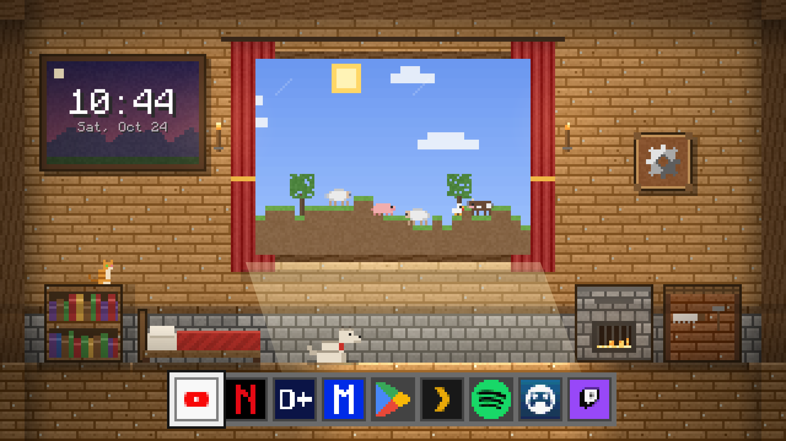
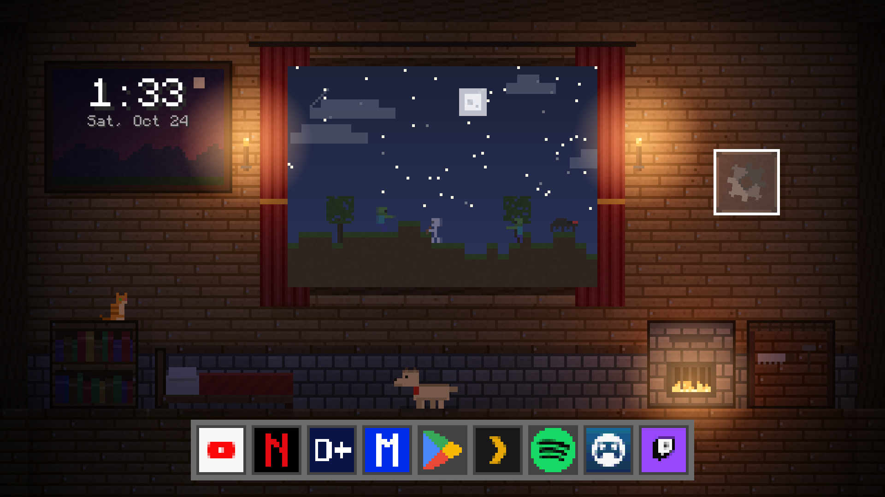

# CleanYourTV — Blocky Cabin launcher

A fork of the [CleanYourTV](https://github.com/Gathin23/cleanyourtv) Android TV launcher with a pixel-art
**blocky cabin** home screen. Built and tested on a Magyar Telekom SDMC DV8519B box (Amlogic, Android TV 12).
No root, no `INTERNET` permission, `minSdk` 26.





## The blocky theme

- A plank cabin whose window **follows the real sun** for the TV's time zone: blue sky, clouds, farm
  animals and a working farmer by day; stars, a moon, hostile mobs and a sleeping farmer with rising
  Zzz by night.
- **Per-pixel "shader-style" lighting** — daylight from the window, a sun patch on the floor, two torches
  and a furnace that glow after dark, ambient shadow in corners and under furniture — computed once into a
  cached image and only redrawn when a light changes.
- A **dog** and a **cat** the farmer pets (hearts), a **clock** on the wall painting, a furnace with a live
  fire, a chest, a workbench.
- A **9-slot hotbar**: apps with hard-to-read wordmark icons get big blocky letters (Netflix `N`,
  Disney+ `D+`, Max `M`), set in `config.xml`.
- A matching **painting-style screensaver** (DreamService).
- Switch **Clean / Blocky** in *Settings → Theme*; it's remembered.

It keeps the reference launcher's features too: the clean theme, Inputs, on-TV settings, and no network
access (it targets 1 GB TVs).

## Build & install

JDK 17, Android SDK platform 34, build-tools 34.0.0.

```bash
./gradlew assembleDebug
adb connect <tv ip>:5555
adb install -r app/build/outputs/apk/debug/app-debug.apk
adb shell cmd package set-home-activity app.cleanyourtv.launcher/.HomeActivity
```

The dock apps, the blocky letters and the Live TV target live in
[`app/src/main/res/values/config.xml`](app/src/main/res/values/config.xml).

## Credit & licence

A fork of **[CleanYourTV](https://github.com/Gathin23/cleanyourtv)** by Gathin and contributors (MIT). This
fork is MIT too — see [`LICENSE`](LICENSE). Bundled fonts: **Outfit** (OFL, see `FONT-LICENSE.txt`) and
**Monocraft** (see `MONOCRAFT-LICENSE.txt`).

> This is an unofficial fork, not maintained by the upstream project. Only debloat or re-home a TV you own.
